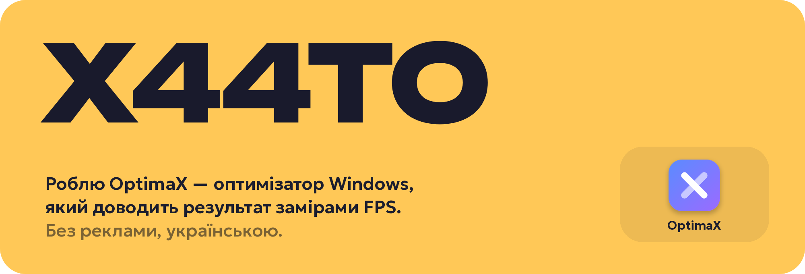
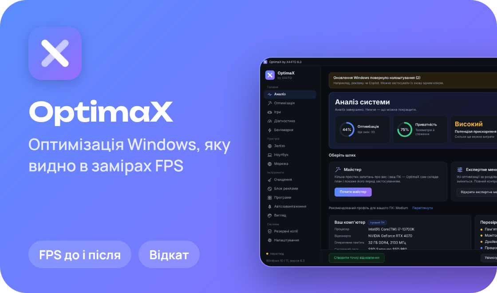

  

Привіт! Я роблю **OptimaX** — безкоштовний оптимізатор Windows 10 і 11 для ігор. Він не просто міняє налаштування, а заміряє FPS до і після, лишає те, що справді допомогло, і повертає будь-яку зміну назад. Без реклами й трекерів, українською.

🇬🇧 OptimaX is a free Windows 10/11 optimizer for gaming that proves every change with before/after FPS tests and can roll everything back. The repository has an English README.

## OptimaX

  

  
  &nbsp;
  

- **Доводить цифрами.** Тест FPS «до і після» і розумна оптимізація, яка сама знаходить і прибирає зміну, з якою стало гірше.
- **Будь-що можна повернути** — саме до ваших значень, навіть із безпечного режиму.
- **Hardware Center** — тести й діагностика заліза, FPS-оверлей без ін'єкцій у гру, перевірка ПК перед покупкою.
- **Ігри на майнінгових картах** P106 / CMP.

## Як я роблю

- **Без реклами й трекерів.** Жодних банерів і збирання даних про вас.
- **Кожну зміну можна повернути.** OptimaX запам'ятовує, що змінив у системі, і повертає все одним натисканням.
- **Перевірено на справжній Windows.** Перед кожним релізом GitHub Actions застосовує, перевіряє й відкочує кожну оптимізацію.
- **Код відкритий.** Можна подивитися, як усе працює, і зібрати самому.

## Інструменти

  
  
  
  

  <picture>
    <source media="(prefers-color-scheme: dark)" srcset="https://raw.githubusercontent.com/hatogg/hatogg/output/snake-dark.svg">
    
  </picture>

  

