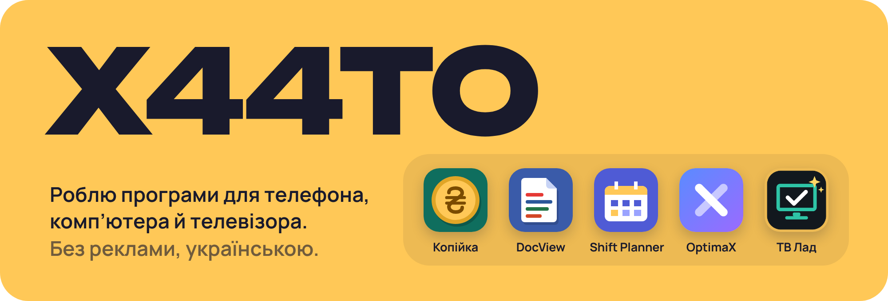
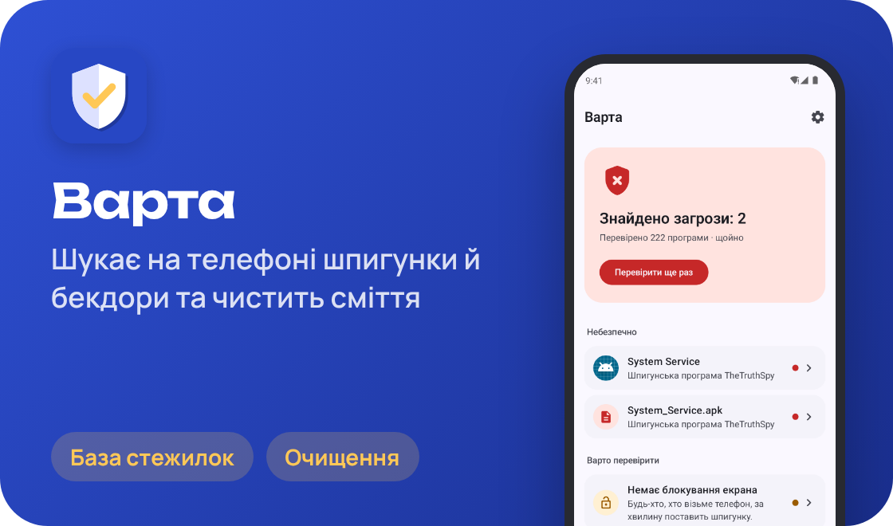
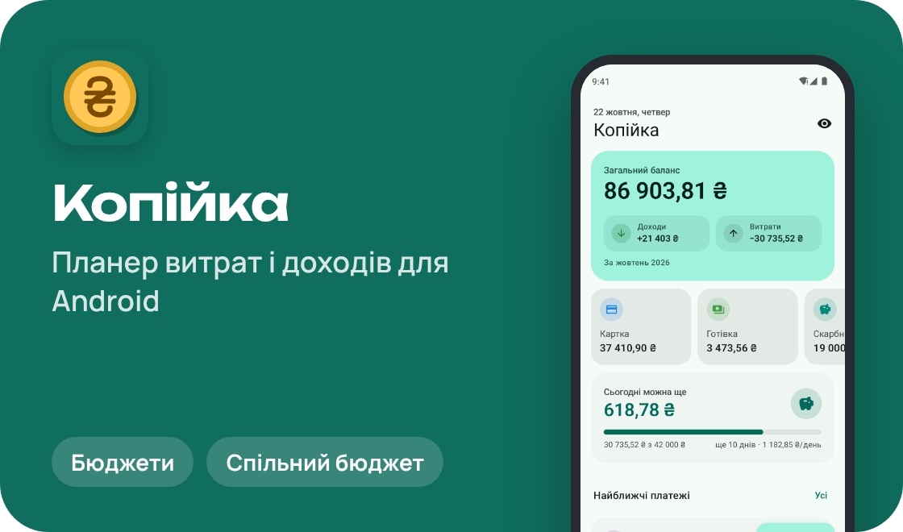
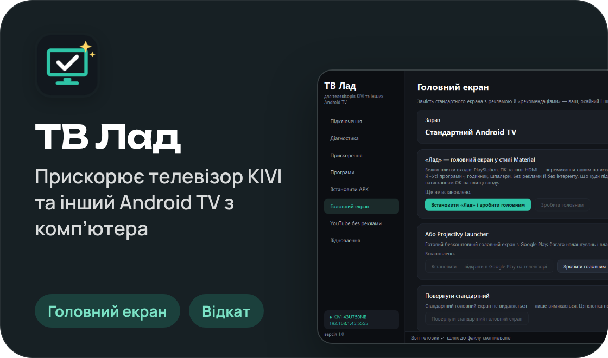
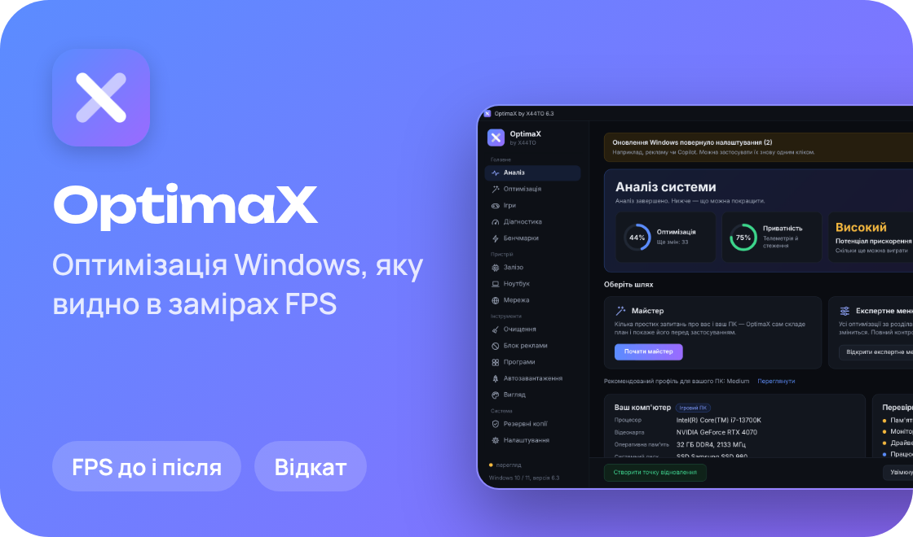
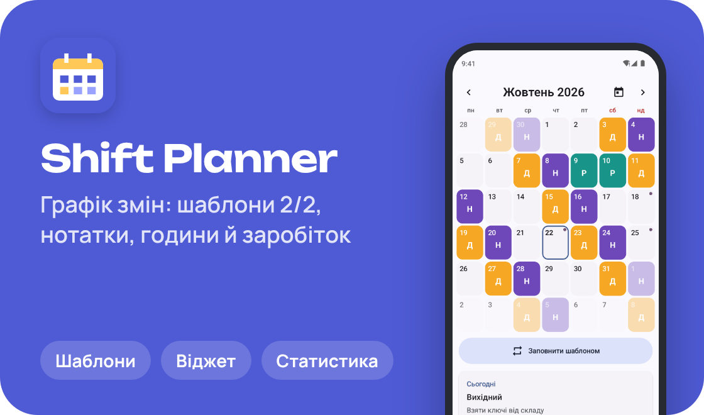
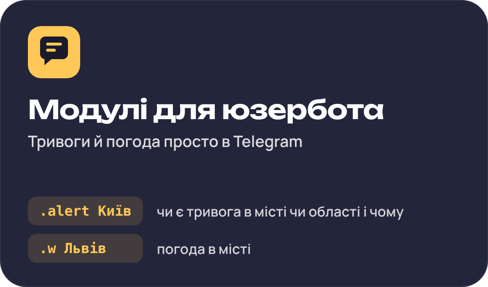
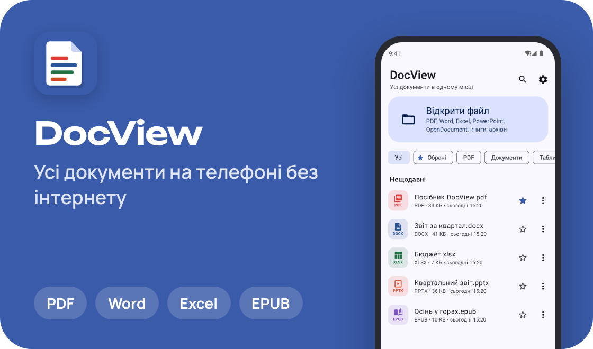
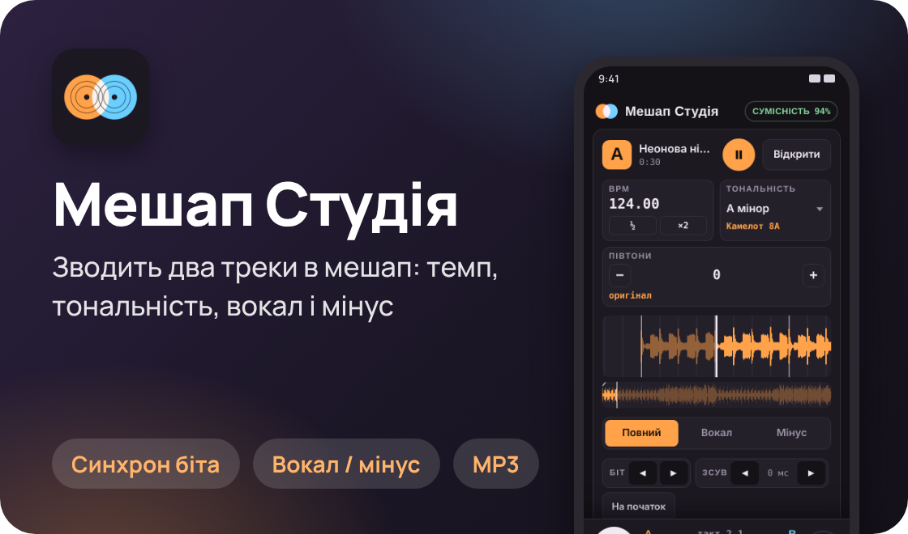

  

Привіт! Я роблю програми, якими користуюся сам: захист телефона від шпигунок, планер витрат, графік змін, переглядач документів, студію для мешапів, оптимізатор Windows і програму, що наводить лад у телевізорі. Без реклами й трекерів, з українським інтерфейсом.

🇬🇧 Apps for Android, Windows and Android TV, with no ads. Most projects have an English README.

## Проєкти

  
  

  
  

  
  

  
  

## Як я їх роблю

- **Без реклами й трекерів.** Жодних банерів і збирання даних про вас.
- **Кожну зміну можна повернути.** OptimaX і ТВ Лад запам’ятовують, що змінили в системі, і повертають усе одним натисканням.
- **Скріншоти справжні.** GitHub Actions збирає кожну Android-програму, запускає її в емуляторі й проходить екранами з демо-даними.
- **Код відкритий.** Можна подивитися, як усе працює, і зібрати самому.

## Зараз роблю

**«Мешап Студія»** для Android: відкриваєте два треки, а програма знаходить їхній темп і тональність, зводить біт у біт, відділяє вокал від мінусу й робить автопереходи. Готовий мешап одразу грає, а зберігається в MP3. Без інтернету й реклами. [Завантажити APK](https://github.com/hatogg/mashup-studio/raw/main/apk/MashupStudio.apk)

## Інструменти

  
  
  
  
  
  
  
  

  <picture>
    <source media="(prefers-color-scheme: dark)" srcset="https://raw.githubusercontent.com/hatogg/hatogg/output/snake-dark.svg">
    
  </picture>

  

